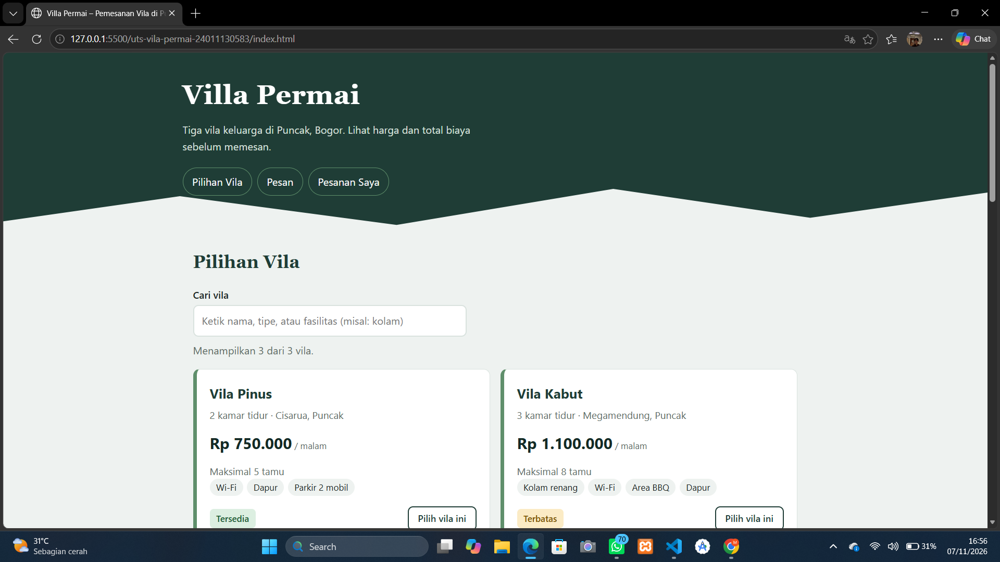

# uts-vila-permai-24011130583

Ujian Tengah Semester – Teknologi Web: Aplikasi Pemesanan Villa

- **Nama**: Muhammad Rido I
- **NIM**: 24011130583
- **Kelas**: MI5B
- **Nama repository**: `uts-vila-permai-24011130583`

## Deskripsi
Halaman web statis (HTML + CSS + JavaScript) untuk pemesanan vila "Villa Permai" di Puncak, Bogor.
Tidak memakai server maupun basis data. Seluruh data vila ada di array objek pada `script.js`.

## Cara Menjalankan
1. Unduh atau *clone* repository ini.
2. Buka file `index.html` di browser (klik dua kali). Tidak perlu instalasi apa pun.

## Fitur
- [x] Tiga kartu vila yang dirender dari data JavaScript (`createElement` + `appendChild`)
- [x] Pencarian vila berdasarkan kata kunci
- [x] Dropdown pilihan vila terisi otomatis dari data
- [x] Total biaya otomatis tampil sebelum tombol pesan ditekan
- [x] Cek ketersediaan tanggal (mencegah jadwal bentrok)
- [x] Validasi input dengan pesan berbahasa Indonesia
- [x] Nama terakhir dan daftar pesanan tersimpan di `localStorage`
- [x] Tampilan responsif (breakpoint 768px dan 480px)
- [ ] Pembayaran online (belum ada)
- [ ] Notifikasi otomatis ke pemilik (belum ada, pesanan baru tersimpan di peramban tamu)

## Aturan Harga
`total = harga per malam × jumlah malam + biaya tambahan`.
Tamu di atas 4 orang dikenai Rp 50.000 per tamu per malam.

## Tangkapan Layar


## Struktur File
```
index.html
style.css
script.js
README.md
.gitignore
screenshots/halaman-utama.png
```
